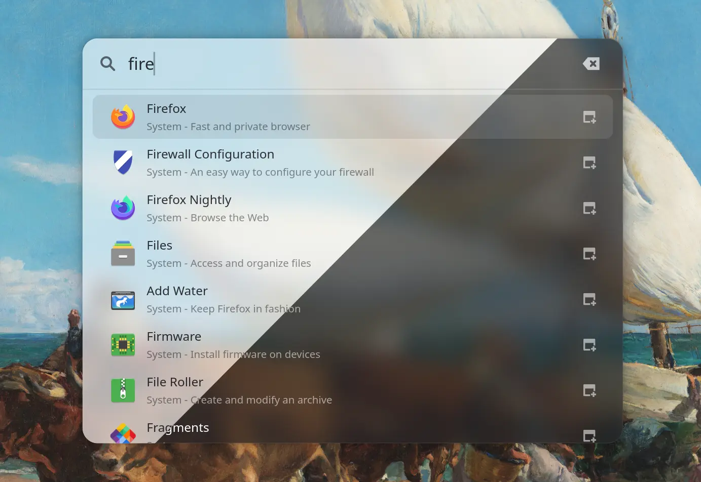

<div align="center">
  <h1>Adwaita Launcher</h1>
  
</div>

An application launcher for Linux, built with libadwaita, a frontend for [pop-launcher](https://github.com/pop-os/launcher). Similar to `cosmic-launcher` for the Cosmic Desktop environment.

## Building

You need the GTK 4 and libadwaita development packages to build it, and `pop-launcher` on your `PATH` at runtime.

```sh
cargo install --git https://github.com/SchutteJan/adwaita-launcher --locked
```

Bind `adwaita-launcher` binary to a keyboard shortcut, (full path `~/.cargo/bin/adwaita-launcher`).


## Blur support

For the background blur to work, your Wayland compositor must support the [`ext-background-effect-v1`](https://wayland.app/protocols/ext-background-effect-v1) protocol. 

For GNOME Shell you need version 51 or higher. 

## Startup Time

I've been actively optimizing the startup time of Adwaita Launcher. 
Applications built with GTK4 load system themes and icons when starting up,
which takes considerable time. My goal is to have the "time to first render" be below 50ms, on my machine I am currently at 108ms.

Benchmark using this command:

```sh
hyperfine --warmup 1 'adwaita-launcher --exit-after-first-frame'
```

### Icon theme
I've found a 150ms improvement simply by switching icon theme from `Papirus-Adapta-Maia` to `Adwaita`, likely because the number of icons is smaller in the latter. Note that switching will make all GTK based applications faster to start. 

Change icon theme using the GNOME Tweaks utility.
